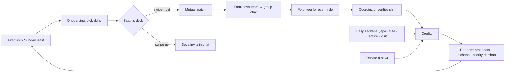
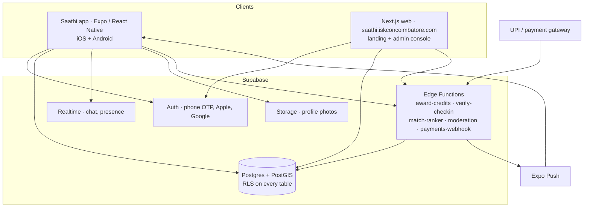

# Saathi – architecture & product design

**Saathi** (Sanskrit/Hindi: *companion*) is a community app for ISKCON Coimbatore. It helps occasional visitors become regulars: they find devotees whose skills complement theirs, serve at temple events together, keep a daily sadhana, and earn credits they can redeem for prasadam, archana and festival passes.

## 1. The problem, and how the app answers it

| ISKCON Coimbatore's ask | What Saathi does | Where it is in the prototype |
|---|---|---|
| Visitors come and go: how do we get them to **visit regularly**? | Geo + QR temple check-in, daily streaks, a 30-day bonus, and an arati schedule with the next arati highlighted | Sadhana tab |
| Help them **adopt the bhakti process** | Japa counter (108 beads × 16 rounds), Gita chapter tracker, lecture hearing, five-week heatmap | Sadhana tab |
| Let them **offer services based on skills** | Skill-based matching of devotees, event roles tagged by skill, "Needs your skills" feed | Saathis tab, Seva tab |
| Visitors can **club together** | Swipe to connect; on a mutual match, form a seva team with a group chat; circles as micro-communities | Saathis tab, match screen, Sangha tab |
| People **without a special skill** still contribute | Chanting, serving and welcome roles at every event; Japa Sunrise Club open to all; "New devotees to guide" filter | Everywhere |
| **Credits** for visits, programmes, Gita, lectures and seva | Append-only ledger with configurable rules and daily caps | Rewards screen |
| **Redeem** for gifts, prasadam, priority passes and archana | Catalogue with a code you show at the counter | Rewards screen |
| **Donations, annadaan, building, all sevas** | Real funds and tiers from iskconcoimbatore.com: Annadaan, Kovai Chandra, Gau Seva, Vidya Daan, Vaishnav Bhojan | Seva tab → Donate |
| Contacts **only visible to admins** | Contact details are kept in a separate table protected by row-level security; devotees talk through in-app chat | Profile screen, Admin console |

## 2. Experience map

The loop: **visit → connect → serve → earn → redeem → visit again.**

## 3. Design language

- **Palette:** saffron (seva), peacock teal (Krishna), tulasi green (sadhana), lotus pink (sangha) and temple gold (rewards), on a warm sandalwood background with a deep-night dark mode. Tokens are in `packages/shared/tokens.js` and shared by the mobile and web apps.
- **Type:** Fraunces for headings (devotional, editorial serif) and Inter for interface text.
- **Motif:** a 16-petal lotus mandala drawn in SVG; no stock photos of real people.
- **Motion:**
  - The swipe deck uses spring physics and runs on the UI thread with Reanimated 4 and Gesture Handler 3.
  - Haptics on every tap, swipe and completed japa round.
  - A breathing glow when a round completes.
- **Accessibility:**
  - Touch targets are at least 44 pt, and icon-only buttons have accessibility labels.
  - Screen-reader hints on the swipe card.
  - Text contrast is at least 4.5:1, and every screen supports dark mode.

## 4. System architecture (production)

- **The client never writes credits.** The app writes a `sadhana_log` row or a role signup. The `award-credits` Edge Function validates it (caps, geofence, coordinator verification) and inserts into `credit_ledger`. A `unique(source)` constraint makes every award idempotent.
- **Temple check-in** requires two signals:
  - The device's location must be inside the temple's PostGIS geofence (150 m).
  - The devotee scans a QR code that rotates every 60 seconds, shown at the entrance kiosk.

  Together these stop people earning visit credits from home.
- **Matching (`match-ranker`)** scores each pair of devotees. The strongest signal is complementary skills for open roles at an upcoming event. Shared circles, shared availability, language and an active streak add to the score. The prototype's version of this is in `apps/mobile/src/lib/match.ts`.
- **Privacy:**
  - Mobile numbers and emails are only in `member_private`, which only admins can read under row-level security.
  - The moderation function flags chat messages that contain phone numbers or emails.
  - All of this is in `supabase/migrations/0001_saathi_core.sql`.
- **Multi-temple:** every table is keyed by `temple_id`, so after Coimbatore other centres can launch by adding a row (geofence, sevas, rewards, credit rules).

## 5. What's in the prototype

| | Prototype | Production |
|---|---|---|
| Data | Typed mock data in `apps/mobile/src/data/*`, plus a Zustand store persisted to AsyncStorage | Supabase, behind the same hooks |
| Sevas, timings, deities | Real, from iskconcoimbatore.com | Admin-editable |
| Event dates and role counts | Samples, to confirm with the temple | Admin console |
| Check-in | Simulated geofence | expo-location plus rotating QR |
| Payments | Not taken | UPI / payment gateway, with 80G receipts by email |
| Admin | A switch on the Me screen | `member.role = 'admin'` set server-side |

## 6. Roadmap

1. **Pilot (4 weeks):**
   - Supabase backend, phone OTP sign-in and the QR kiosk.
   - 50 devotees at the Sunday feast.
   - Measure visitor → regular conversion on the admin funnel.
2. **Festival season:**
   - Gita Jayanti and Vaikuntha Ekadashi staffing run through Saathi.
   - Push reminders for arati times and team shifts.
3. **Growth:**
   - Web admin console in Next.js.
   - Tamil localisation.
   - In-app audio for lectures (expo-audio).
   - Bhakti Vriksha group tracking.
   - Expansion to other ISKCON centres.
